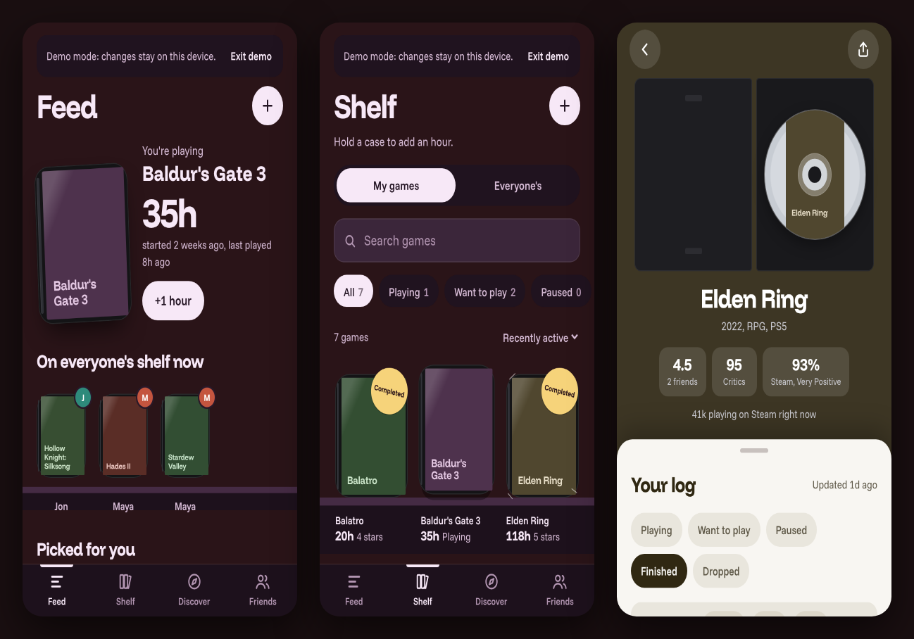

# Save Point

A private, shared game log for a group of friends. Everyone logs what they're playing, want to play, paused,
finished or dropped, with half-star ratings, hours and reviews, and sees everyone else's shelf. It runs as a
home-screen app on iPhone (and in any browser), costs nothing to host, and needs an invite code to join.



_Demo data shows title-only cases; real games get their cover art from IGDB._

## What it does

- **Feed**: your current game with a big hours counter and a one-tap "+1 hour", what friends are playing right
  now, picks for you, and the latest activity with "new since you last opened".
- **Shelf**: your games as cases on ledges, with status stickers (Completed, Paused, Traded in, shrink-wrap for
  Want to play) and wear that grows with hours. Hold a case to add an hour. Search, filter by status, sort.
- **Game page**: the case opens, the disc settles in the tray, and a booklet holds your log (status, rating,
  hours, review with a spoiler toggle, start/finish dates), friends' logs, and scores from friends, critics (IGDB)
  and Steam.
- **Discover**: Trending (Steam's most played, mapped to IGDB, with why it's trending) and a release Calendar that
  includes everyone's Want to play games.
- **Friends**: a card per member with taste match, and a page per friend grouped by status.
- **Catalogue**: add games by searching IGDB; covers, platforms, genres, summary and critic score fill themselves
  in. Adding by hand still works.
- **Share**: your review as a 1080×1350 image, drawn in the browser.
- **Demo mode**: `?demo` (or "Try the demo" on the sign-in screen) runs the whole app on sample data in your
  browser, no account needed.

## Run it locally

You need Node 22. The site itself has no build step; npm only installs the test and lint tools.

```bash
npm ci
npx playwright install chromium   # once, for the browser tests
npm run test:e2e                  # serves the site on http://localhost:8765 while the suites run
```

To click around yourself, serve the folder with any static server and open `/?demo`:

```bash
npx serve .            # or: python3 -m http.server 8000
```

Without `?demo` the app talks to the Supabase project in `config.js`. That file holds the project URL and the
publishable key (public by design; row-level security keeps the data private). To point a copy at your own
project, create the schema with the setup SQL (kept in the private notes repo) and put your URL and key there.

Other scripts: `npm test` (unit + browser tests), `npm run test:unit`, `npm run lint` (ESLint + Prettier check),
`npm run format`.

## Architecture in one paragraph

Plain HTML, CSS and ES modules, no framework, served straight from this repo by GitHub Pages. `src/main.js`
registers each feature (`src/features/*`) with a small shell (`src/app`, `src/ui`) through four registries (tabs,
sheet kinds, actions, forms); screens are functions of one state object that return HTML. All data access goes
through `S.api`, which is either `SupabaseApi` or the offline `DemoApi` (`src/data`). The backend is one Supabase
project: Postgres with row-level security on every table, email/password auth, realtime on `games` and `entries`,
and an Edge Function that holds the IGDB/Steam credentials. A service worker pre-caches the app shell. The full
story, including where the planned price predictor and spoiler-free guide plug in, is in
[docs/ARCHITECTURE.md](docs/ARCHITECTURE.md); the access-rules review is in [docs/rls-audit.md](docs/rls-audit.md).

## Tests and CI

- `tests/unit/`: `node:test` suites for the pure modules, including guards that the service worker pre-caches
  every module and that the module layers only import downwards.
- `tests/suites/`: Playwright, phone-sized, against a local copy of the site. `smoke.js` walks the main user
  flows; the others cover regressions, picks and sharing, Discover, and the real `SupabaseApi` against a mocked
  Supabase.
- GitHub Actions runs lint, unit and browser tests on every push and pull request, and a daily live check of the
  Edge Function's health endpoint.

## Licence

MIT, see [LICENSE](LICENSE). Game data comes from [IGDB](https://www.igdb.com) (via Twitch) and Steam; cover art
is loaded from IGDB and is their respective owners'. Fonts: Funnel Display and Funnel Sans, SIL Open Font Licence
(`fonts/OFL-Funnel.txt`).
